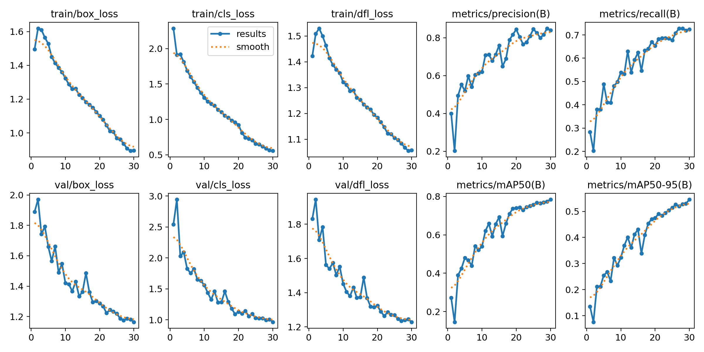

# nereid

Marine-debris detection in underwater images and video.

This project studies transfer learning for underwater object detection using
Ultralytics YOLOv8n and TrashCan-Instance. It covers annotation conversion,
fine-tuning, validation and inference on video. The detector uses a single class,
`marine_debris`, combining the dataset's 14 trash categories.

The trained checkpoint is included in [`models/best.pt`](models/best.pt).

## Results

Baseline run: 30 epochs, image size 640, batch size 16, seed 42, NVIDIA Tesla T4.
Training started from the COCO-pretrained `yolov8n.pt` checkpoint. Ultralytics
version: 8.4.218.

| Validation metric | Value |
| --- | ---: |
| Precision | 84.00% |
| Recall | 72.42% |
| mAP50 | 78.44% |
| mAP50–95 | 54.55% |

These are the recorded metrics at epoch 30, the best epoch by validation
mAP50–95. The logs and environment details are in [`reports/baseline`](reports/baseline).



The original split contains frames from **113 videos in both training and
validation**. Correlated frames can make validation results optimistic.
These numbers describe the original split; they are not an evaluation on
independent, unseen videos. A split grouped by source video is the next
evaluation step.

## Setup

Python 3.10+ and FFmpeg are required. Install FFmpeg separately and make sure
`ffmpeg` is available on your PATH. For GPU execution, use a CUDA-compatible
PyTorch installation.

```bash
git clone https://github.com/jonatasrle/NEREID.git
cd NEREID
python -m venv .venv
```

Activate the environment with `.venv\Scripts\activate` on Windows or
`source .venv/bin/activate` on Linux/macOS, then install the package:

```bash
python -m pip install -e .
```

## Run detection

```bash
nereid predict --source path/to/video.mp4 --output runs/video
```

This writes `detections.mp4` and `summary.json` to the output directory.
The MP4 uses H.264 and keeps the original audio when present. The source frame
rate is preserved. The summary reports processing speed separately from the
video's playback frame rate; detections across frames are not unique-object counts.

```bash
nereid predict --source path/to/video.mp4 --confidence 0.40 --device cpu --output runs/video_cpu
```

For a local camera, use its device index. A desktop display is required:

```bash
nereid predict --source 0
```

Use `--weights path/to/best.pt` to select another checkpoint. The same option
also accepts a training-results ZIP containing a single `best.pt` file.
GPU throughput and live-camera latency depend on the device and input resolution.

## Dataset

[TrashCan 1.0](https://conservancy.umn.edu/handle/11299/214865) contains underwater
observations sourced from JAMSTEC's J-EDI imagery. Use **TrashCan-Instance** for this
experiment. Dataset images and source annotations are not bundled with the code.

Download the original dataset, then convert its Instance version:

```bash
nereid prepare --source path/to/instance_version.zip --output data/trashcan
```

An extracted `instance_version` directory is also accepted. The converter uses
COCO bounding boxes, clips boxes to image boundaries and exports normalized YOLO
labels. Categories starting with `trash_` become class 0; animals, plants and ROVs
are excluded from the target class. Images with no trash annotations receive
empty label files. The original training/validation assignment is preserved.

| Split | Images | Trash boxes | Images without trash |
| --- | ---: | ---: | ---: |
| Train | 6,065 | 4,766 | 1,944 |
| Validation | 1,147 | 1,240 | 206 |

The conversion report records per-category counts, annotation checksums and
shared video IDs. Missing images, invalid boxes and exact image duplicates
across splits stop the conversion. The converter expects COCO JSON annotations
from the Instance version; raw bitmap annotations require a separate conversion.

## Train and evaluate

```bash
nereid train --data data/trashcan/data.yaml --device 0
nereid evaluate --data data/trashcan/data.yaml --weights models/best.pt --device 0
```

The training configuration is in [`configs/train.yaml`](configs/train.yaml).
Each run saves its checkpoint, metrics and resolved training arguments. To
change the number of epochs without editing the configuration:

```bash
nereid train --data data/trashcan/data.yaml --epochs 50 --name experiment_50 --device 0
```

Reruns can vary with PyTorch, CUDA and hardware versions. The recorded baseline
environment is preserved in `reports/baseline/environment.json`.

## Tests

```bash
python -m pip install -e ".[dev]"
python -m pytest
```

Tests cover coordinate conversion, class mapping, negative images, archive
handling and checkpoint selection. They do not measure detection accuracy.

## Scope and next steps

- Evaluate with source videos kept in separate splits.
- Review false positives and missed small or partially occluded debris.
- Compare inference latency across CPU/GPU and input sizes.
- Study model export and quantization for deployment on embedded hardware.

## References and license

- Hong, J., Fulton, M., and Sattar, J. (2020).
  [TrashCan: A Semantically-Segmented Dataset towards Visual Detection of Marine Debris](https://arxiv.org/abs/2007.08097).
- [Ultralytics YOLOv8](https://docs.ultralytics.com/models/yolov8/)
- [Ultralytics training](https://docs.ultralytics.com/modes/train/) and
  [prediction](https://docs.ultralytics.com/modes/predict/) documentation.

Code: [AGPL-3.0](LICENSE). The architecture and initial pretrained weights are
provided by Ultralytics. The study checkpoint was fine-tuned on TrashCan-Instance.
TrashCan and JAMSTEC imagery remain subject to their original terms and attribution.

